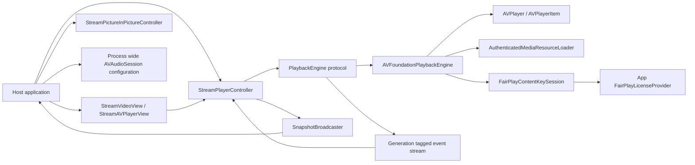

# Architecture and dependencies

## Inventory and dependency direction

| Component | Responsibility / ownership | Evidence |
|---|---|---|
| `StreamPlayerController` | Public per-player API, intent/state, event task, audio interruption policy, load generation, snapshot broadcaster | `Sources/StreamKit/PublicAPI/StreamPlayerController.swift:11-55, 110-221, 613-719` |
| `PlaybackEngine` | Internal seam for operations and generation-tagged event stream | `Sources/StreamKit/PlaybackCore/PlaybackEngine.swift` |
| `AVFoundationPlaybackEngine` | Owns one `AVPlayer`, item/observers, resource loader, FairPlay session | `Sources/StreamKit/PlaybackCore/AVFoundationPlaybackEngine.swift:12-60` |
| `SnapshotBroadcaster` | Owns subscriber continuations and finishes them at shutdown | `Sources/StreamKit/PlaybackCore/SnapshotBroadcaster.swift:10-72` |
| `AuthenticatedMediaResourceLoader` | Per-source isolated URLSession, request tasks, HLS URI rewriting and byte-range validation | `Sources/StreamKit/PlaybackCore/AuthenticatedMediaResourceLoader.swift:140-235` |
| `FairPlayContentKeySession` / `FairPlayKeyExchange` | Per-source AVContentKeySession and provider exchange | `Sources/StreamKit/PlaybackCore/FairPlayContentKeySession.swift:4-55`; `FairPlayKeyExchange.swift` |
| `StreamVideoView` | SwiftUI/UIViewRepresentable bridge to controller's player layer; view does not own playback lifecycle | `Sources/StreamKit/PublicAPI/StreamVideoView.swift:14-69` |
| PiP controllers | Explicit custom-layer PiP adapter and AVKit player-view adapter | `StreamPictureInPictureController.swift`; `StreamAVPlayerView.swift` |
| Demo | Consumer integration examples including audio/session and fullscreen | `Examples/StreamKitDemo/` |



## Lifecycle / event ownership

```mermaid
sequenceDiagram
  participant App
  participant C as StreamPlayerController
  participant E as AVFoundationPlaybackEngine
  participant P as AVPlayer / AVPlayerItem
  participant S as SnapshotBroadcaster
  App->>C: load(source)
  C->>C: advance loadGeneration, cancel prior task, publish loading
  C->>E: load(source, generation)
  E->>P: replace item, install observers
  P-->>E: readiness/status/time/end callbacks
  E-->>C: generation-tagged events / readiness result
  C->>C: reject stale generation; update snapshot
  C->>S: publish snapshot
  S-->>App: per-subscriber latest snapshot
  App->>C: shutdown()
  C->>E: shutdown and release observers/items
  C->>S: publish idle and finish streams
```

`StreamPlayerController` is the observable state source; `AVPlayer` is the observed playback source. Engine callbacks are normalized into internal events and then snapshots. Public errors use `PlaybackFailure`; resource and FairPlay paths map or redact lower-level failures before surfacing them. The app owns the process-wide audio-session category/activation and background mode; the package subscribes to interruption notifications.

## Package configuration

`Package.swift:1-30` declares Swift tools 6.4, one iOS 16 library product/target, one test target, no external dependencies/resources, and `ApproachableConcurrency` for both targets. This is appropriately small and avoids supply-chain exposure. Package code uses UIKit/SwiftUI/AVKit behind `#if os(iOS)` where relevant. No CI workflow or lint configuration was found by repository file search. The demo Xcode project is separate from the SwiftPM product and currently declares iOS 26.5 and Swift 5 language mode (project file lines 323-527); thus it does not demonstrate consumer compatibility near the package's iOS 16 floor.

**DEP-001 — Medium, Enhancement:** add CI builds/tests for the package and a minimum-supported iOS simulator compile, plus demo integration compilation. Exact config insertion point: new `.github/workflows/` workflow (directory not present); no existing configuration should be presumed. Keep dependency graph empty unless a concrete need appears. SwiftPM build artifacts should use external scratch paths in restricted environments.

**ARCH-001 — Medium, Enhancement:** boundaries are reasonably cohesive; the engine protocol enables controller tests, while `StreamPlayerController.renderingPlayer` downcasts its engine to `AVFoundationPlaybackEngine` (`StreamPlayerController.swift:37-40`) to support the video view. This is a deliberate but concrete abstraction leak. If alternate rendering engines become a requirement, add an internal rendering capability protocol returning the render surface; do not generalize now without a second implementation. A minimal patch proposal is recorded in `11_PATCH_PROPOSALS.md`.

## Ownership and coupling

| Resource | Owner | Lifetime/cleanup evidence |
|---|---|---|
| `AVPlayer`, item observers, time observer | Engine | `AVFoundationPlaybackEngine.swift:12-50, 504-525, 757-781` |
| Load readiness continuation | Engine | pending fields and `completeReadiness` / `cancelPendingReadiness` |
| load task and event task | Controller | `StreamPlayerController.swift:43-55, 613-641` |
| snapshot continuation per subscriber | Broadcaster | `SnapshotBroadcaster.swift:14-42, 55-72` |
| bearer request tasks and URLSession | Auth loader | `AuthenticatedMediaResourceLoader.swift:140-235` |
| DRM request tasks, active requests, key recipient | FairPlay session | `FairPlayContentKeySession.swift:10-55` |
| custom layer registry and AVKit PiP controller | PiP controller | `StreamPictureInPictureController.swift:39-49, 88-120` |
| audio category, activation, background entitlement | Host app | public config/docs and demo `Info.plist` |

Dependency direction is app → public API → internal controller/engine → AVFoundation; the FairPlay protocol deliberately points integration outward to the app. Track IDs are positional identifiers derived from current selection groups, not durable asset identifiers (`AVFoundationPlaybackEngine.swift:528-627`); consumers should retain them only for the current item.

## Code/config observations

No third-party package dependency or packaged asset requirement exists. `Package.swift` does not declare library evolution (`BUILD_LIBRARY_FOR_DISTRIBUTION` is an Xcode setting, not declared here); source compatibility should be controlled with release tags and API tests. Since SwiftPM packages are normally built from source, binary library evolution is not a current blocker. Minimum OS and compiler feature compatibility should be exercised in CI. No actionable dependency removal is supported by evidence.
