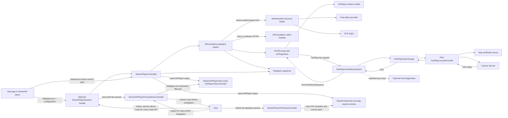

# StreamKit Architecture

For a practical source map and change guide, see [Contributing to StreamKit](Contributing.md).

## Public API Responsibilities
- `StreamPlayerSession` and `StreamPlayerView`: managed SwiftUI integration for a media source, snapshots, AVKit presentation, and safe PiP-aware shutdown
- `StreamPlayerController`: Main interface for applications to control playback
- `StreamVideoView` and `StreamAVPlayerView`: app-owned rendering and lower-level AVKit presentation surfaces
- `MediaSource`: Represents media to be played (URL, file, etc.)
- `PlayerConfiguration`: Immutable settings for player behavior

## PlaybackCore Responsibilities
- `PlaybackIntent`: Describes what the application wants (play/pause)
- `PlaybackPhase`: Describes what the player is currently doing
- `PlaybackSnapshot`: Captures playback state at a point in time
- `PlaybackFailure`: Carries normalized playback error information
- `MediaBearerAuthentication`: Supplies per-resource bearer tokens scoped to exact HTTPS hosts
- `FairPlayConfiguration` and `FairPlayLicenseProvider`: Bind a source to the app-owned FairPlay certificate/content-ID/license-server integration

## Separation of Concerns
- **PlaybackIntent** (application-driven) is independent of **PlaybackPhase** (player-driven)
- Intent does not change automatically based on buffering or transient states
- Phase reflects actual player state regardless of application requests

## Playback Coordinator
- `StreamPlayerController` reconciles Intent and Phase to drive playback behavior
- Playback resumes after buffering when intent is `.play`
- Playback remains paused after buffering when intent is `.pause`
- State changes are published through playback snapshots
- Each controller consumes interruption events from an injected `AudioInterruptionSource`. The system adapter owns the iOS notification subscription and translates notifications into small `Sendable` events; the controller applies policy, pauses its own engine, and conditionally resumes when the interruption ends. Resumption requires a prior play intent, the configured policy, and iOS's `shouldResume` indication.

## Audio Session Ownership
- `AVAudioSession` is process-wide; the host app owns its category, mode, activation, and background-audio capability.
- StreamKit observes interruptions per controller. The adapter owns and removes its notification observer during `shutdown()`, while tests inject a controllable source without depending on global notification state.
- `PlayerConfiguration.automaticallyResumesAfterAudioInterruption` defaults to `true`; explicit user pause during an interruption prevents resumption.
- Every live controller independently observes the same process-wide interruption. Controllers that share an `AudioPlaybackFocusCoordinator` also share an app-scoped single-active-player policy: a new play request pauses the previously focused StreamKit controller. Without a coordinator, controllers remain independent. The coordinator does not configure `AVAudioSession` or arbitrate audio with other apps.
- `AVAudioSession` is a shared singleton. The host app owns category, mode, activation, mixing, route, and background-audio decisions; StreamKit only observes interruption events and coordinates its own controllers when the host opts in. Apple recommends deferring activation until playback begins when possible.
- Live timeline updates are sampled from `AVPlayerItem.currentTime()`, `currentDate()`, and `seekableTimeRanges`. Ranges may be discontinuous; the newest range end is the current seekable-window boundary, not a promise of zero latency. AVFoundation may stop refreshing live seekable ranges while paused unless extra live network activity is enabled, which has a power cost.
- The demo configures `.playback` / `.moviePlayback`, activates the session asynchronously on iOS 27+ (and off the main thread on earlier supported releases), and opts into the `audio` background mode. A consuming app must configure its own target similarly if it needs background audio.
- The demo's synthetic interruption controls exercise notification translation and controller policy; they do not emulate iOS audio routing, Siri, calls, or background execution.

## Runtime architecture diagram

The diagram shows ownership and data flow, not a deployment topology. FairPlay certificate retrieval, key-identifier mapping, license HTTP/authentication, and response-envelope parsing belong to the host provider. The demo's Axinom provider is sample-only. The Axinom public test vector has now played successfully in a live demo run; production-provider and lifecycle acceptance checks remain open.

`StreamVideoView` renders a controller into an `AVPlayerLayer` for app-owned controls. A `StreamPictureInPictureController` coordinates PiP for those custom surfaces; share one instance across views rendering the same controller, and start PiP in response to a user action. The host must retain both controllers in an owner that outlives the player route while PiP is active. The PiP controller retains the source layer until AVKit reports stop or failed start. `try await stopAndWaitUntilStopped()` is the shutdown barrier: await it before shutting down or replacing the playback controller. If the wait is cancelled, it throws while AVKit continues the stop request; retain playback and wait again before shutdown.

`StreamAVPlayerView` is an AVKit-backed surface that provides Apple's standard controls and system PiP/AirPlay affordances where supported. `StreamPlayerSession` is the managed facade: it creates the controller, loads the supplied source, publishes snapshots, and owns the AVKit presentation controller. `StreamPlayerView` renders that session. Its `shutdown()` waits for PiP to finish before releasing playback. Retain the session above the player route if playback or PiP must survive route removal. Supply a restoration handler when the host needs to restore its navigation route; the default reports that no restoration occurred. For custom controls, use `StreamPlayerController` and `StreamVideoView` directly. The host owns process-wide audio-session configuration and the app's `audio` background mode.

### Managed-player feature coverage and ownership

The managed facade changes the **presentation and session-lifecycle entry point**, not the playback engine or source capabilities. A `MediaSource` is loaded by the same controller and engine whether it is presented by `StreamPlayerView`, `StreamAVPlayerView`, or `StreamVideoView`.

| Capability | Managed-player setup | Host-app responsibility |
| --- | --- | --- |
| VOD | Pass a source with `.onDemand` (or leave the kind `.unspecified` if live semantics are not needed). | Supply a playable URL/file. |
| Live and DVR | Pass a source with `.live`; the timeline reports AVFoundation's seekable ranges, and live-edge seeking is available when the stream exposes a seekable window. | Identify the source as live and decide how the UI exposes DVR seeking. |
| Cookies and user agent | Set `cookies` and/or `userAgent` on `MediaRequestConfiguration`. | Supply cookie values and the desired user agent. Authenticated loading uses only explicitly supplied cookies. |
| Bearer-authenticated HLS | Set `MediaRequestConfiguration.bearerAuthentication` on the source. | Provide an async token provider and exact trusted HTTPS media hosts. |
| FairPlay-protected HLS | Set `MediaRequestConfiguration.fairPlay` on the source. | Implement `FairPlayLicenseProvider` for certificate acquisition, content-ID mapping, license-server authentication/protocol, and CKC parsing. |
| Bearer media auth plus FairPlay | Configure both fields on the same `MediaRequestConfiguration` when the origin and key service each require their respective authorization. | Keep media-token authorization separate from license-server authorization. |
| Standard controls and PiP | Render with `StreamPlayerView`; optionally enable automatic PiP on app background. | Retain a `StreamPlayerSession` above the route and provide restoration behavior if playback/PiP must survive navigation. |
| Custom controls | Use `StreamPlayerController` with `StreamVideoView`. | Build controls and own the view/session lifecycle. |

The managed view does not supply DRM credentials or infer whether a URL is live. This is intentional: content type and provider-specific authorization are input configuration, while playback orchestration and AVKit presentation remain SDK responsibilities. Copyable setup examples for each managed option are in the README's [Quick Start](../README.md#quick-start). The demo has a basic managed AVKit route; its bearer and Axinom FairPlay screens use the lower-level controller path to expose those provider workflows and diagnostics. Their configured `MediaSource` values can be passed to `StreamPlayerView(source:)` or a retained `StreamPlayerSession` without changing the DRM/authentication pipeline.

## Platform Boundary
- **Platform-independent**: Intent, Phase, Snapshot, Failure enums
- **Platform-dependent**: Actual AVFoundation integration in player implementation
- Core architecture remains testable and reusable across Apple platforms

## Authenticated Media Requests
- Regular HTTPS media continues through AVFoundation's native `AVURLAsset` loading path.
- Bearer-authenticated media uses an `AVAssetResourceLoader` owned by the playback engine.
- HLS playlist references are rewritten to the resource-loader scheme so tokens can be requested for segments, keys, and child playlists.
- The async token provider is called per resource, allowing the host app to refresh credentials.
- Exact host allowlisting and HTTPS-only transport prevent credentials from being sent to unrelated or cleartext origins.
- The authenticated loader uses an ephemeral URL session with automatic cookie storage disabled; only explicitly configured `MediaCookie` values are attached.
- Finite authenticated byte ranges require HTTP `206` and a matching `Content-Range`; nonzero requests through end-of-resource use an open-ended `Range`. The loader verifies response extent and byte count before finishing the AVFoundation request, and does not treat a ranged response's selected-byte count as the full resource length.
- The demo presents bearer-authenticated playback as a separate example. It is prefilled with a public Mux HLS stream so ordinary playback can be checked without credentials; supplying a token enables the bearer-authenticated path for a protected origin. The public sample does not verify bearer authentication.
- Autoplay keeps the snapshot at `.ready` with `.play` intent until AVFoundation reports `.playing` or `.waiting`, so observed phase reflects the engine instead of the play request.
- Calling `play()` after `.ended` seeks to zero first when the source has a known finite duration. The controller validates the source generation and current play intent after the asynchronous seek, so a replacement or explicit pause cannot be overridden by the late seek completion. Unknown-duration items are not implicitly rewound.
- Play/pause commands carry a controller command generation across asynchronous engine calls. When a stale command completes, the controller reconciles the engine to the latest intent and checks again if a newer command arrives during reconciliation. This prevents a late pause from permanently overriding a newer play (and vice versa). Commands are not globally serialized; an engine must apply each physical side effect before its async method completes.
- AVPlayer time-control observations are checked against the current observed status before publication. Initial `.paused` while an item is still loading is ignored, and the controller ignores `.paused` events that are invalid for its current phase.
- Timeline ranges are sampled alongside playback-time updates. Paused live range refresh is an explicit `PlayerConfiguration` opt-in because AVFoundation may use network and power resources to keep `seekableTimeRanges` current while paused; otherwise a published live timeline can become stale during a pause. See Apple's [`canUseNetworkResourcesForLiveStreamingWhilePaused`](https://developer.apple.com/documentation/avfoundation/avplayeritem/canusenetworkresourcesforlivestreamingwhilepaused) documentation.
- Cancellation from `MediaBearerAuthentication`'s async token provider is preserved as task cancellation rather than being normalized into a generic authentication failure.
- Demo track choices are cached per source revision. A source replacement clears selections and track lists; late track-discovery results from the previous revision are discarded.

## Demo playback-session ownership
- The standalone demo's `StandalonePlayerDemoSession` owns the controller, custom PiP controller, current snapshot, and track state above the player route. The route reports appearance/disappearance; the session pauses and performs terminal shutdown only after the route has disappeared and custom PiP is inactive.
- The demo retains its session at the app's home/root view so SwiftUI route reconstruction does not destroy active playback ownership. Since `shutdown()` is terminal, entering the route after cleanup creates a fresh controller/session.
- This is an example ownership policy, not an SDK requirement. A host app should place the session/coordinator at the scope matching its own background, navigation, and PiP policy.

## FairPlay key loading
- The playback engine owns one `FairPlayContentKeySession` per FairPlay-enabled media item and attaches its `AVURLAsset` as the key recipient.
- `FairPlayContentKeySession` delegates certificate acquisition, content-ID mapping, and SPC-to-CKC server exchange through the `Sendable` app-provided `FairPlayLicenseProvider`.
- StreamKit uses AVFoundation's `AVContentKeySession` API for key loading. It handles initial and renewal requests and removes/cancels the per-item session resources on replacement, cancellation, or shutdown.
- License-server HTTP, server authentication, response-envelope parsing, and certificate retrieval/caching stay outside the core SDK. This keeps DRM vendor dependencies out of StreamKit and makes the provider mockable.
- The bearer loader and FairPlay session are separate. Bearer authentication covers HLS media resources; the FairPlay provider independently authenticates license requests. A source can configure both when required.
- The demo's Axinom FairPlay test adapter is sample-only: it fetches a configured certificate, strips `skd://` from the Axinom key identifier, posts the SPC, and supplies the public test token in `X-AxDRM-Message`. It uses standard `URLSession` and is not a dependency of the StreamKit package. The public test token is embedded only for Axinom's public test asset; diagnostics do not log it. The UI displays request stage and safe HTTP/AxDRM error diagnostics.
- `FairPlayConfiguration` can optionally deliver redacted content-key response accepted/failed events to the host for diagnostics. It excludes content identifiers and DRM payloads; the sample uses it to tell key-response processing apart from later media buffering.
- Persistable/offline keys are rejected as unsupported in this first slice. Playback of Axinom's public FairPlay test vector is verified in a live demo run. Provider-specific renewal, expiry, cancellation, source replacement, and production FPS materials still require validation.
