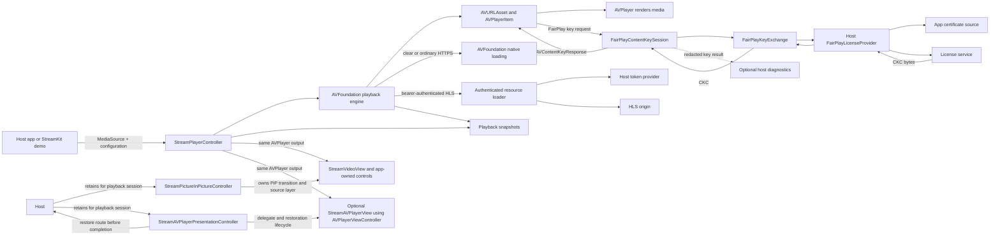

# StreamKit Architecture

## Public API Responsibilities
- `StreamPlayerController`: Main interface for applications to control playback
- `MediaSource`: Represents media to be played (URL, file, etc.)
- `PlayerConfiguration`: Immutable settings for player behavior

## PlaybackCore Responsibilities
- `PlaybackIntent`: Describes what the application wants (play/pause)
- `PlaybackPhase`: Describes what the player is currently doing
- `PlaybackSnapshot`: Captures playback state at a point in time
- `PlaybackFailure`: Carries normalized playback error information
- `MediaBearerAuthentication`: Supplies per-resource bearer tokens scoped to exact HTTPS hosts
- `FairPlayConfiguration` and `FairPlayLicenseProvider`: Bind a source to the app-owned FairPlay certificate/content-ID/license-server integration

## Separation of Concerns
- **PlaybackIntent** (application-driven) is independent of **PlaybackPhase** (player-driven)
- Intent does not change automatically based on buffering or transient states
- Phase reflects actual player state regardless of application requests

## Playback Coordinator
- `StreamPlayerController` reconciles Intent and Phase to drive playback behavior
- Playback resumes after buffering when intent is `.play`
- Playback remains paused after buffering when intent is `.pause`
- State changes are published through playback snapshots
- Each controller consumes interruption events from an injected `AudioInterruptionSource`. The system adapter owns the iOS notification subscription and translates notifications into small `Sendable` events; the controller applies policy, pauses its own engine, and conditionally resumes when the interruption ends. Resumption requires a prior play intent, the configured policy, and iOS's `shouldResume` indication.

## Audio Session Ownership
- `AVAudioSession` is process-wide; the host app owns its category, mode, activation, and background-audio capability.
- StreamKit observes interruptions per controller. The adapter owns and removes its notification observer during `shutdown()`, while tests inject a controllable source without depending on global notification state.
- `PlayerConfiguration.automaticallyResumesAfterAudioInterruption` defaults to `true`; explicit user pause during an interruption prevents resumption.
- Every live controller independently handles the same process-wide interruption. StreamKit does not yet arbitrate audio focus when multiple controllers have play intent; hosts should manage that policy until a shared focus policy is defined.
- The demo configures `.playback` / `.moviePlayback`, activates the session asynchronously on iOS 27+ (and off the main thread on earlier supported releases), and opts into the `audio` background mode. A consuming app must configure its own target similarly if it needs background audio.
- The demo's synthetic interruption controls exercise notification translation and controller policy; they do not emulate iOS audio routing, Siri, calls, or background execution.

## Runtime architecture diagram

The diagram shows ownership and data flow, not a deployment topology. FairPlay certificate retrieval, key-identifier mapping, license HTTP/authentication, and response-envelope parsing belong to the host provider. The demo's Axinom provider is sample-only. The Axinom public test vector has now played successfully in a live demo run; production-provider and lifecycle acceptance checks remain open.

`StreamVideoView` renders a controller into an `AVPlayerLayer` for app-owned controls. A `StreamPictureInPictureController` coordinates PiP for those custom surfaces; share one instance across views rendering the same controller, and start PiP in response to a user action. The host must retain both controllers in an owner that outlives the player route while PiP is active. The PiP controller retains the source layer until AVKit reports stop or failed start. `stopAndWaitUntilStopped()` is the shutdown barrier: await it before shutting down or replacing the playback controller.

`StreamAVPlayerView` is an alternative AVKit-backed surface that provides Apple's standard controls and system PiP/AirPlay affordances where supported. The host retains one `StreamAVPlayerPresentationController` outside the player route for the playback session. It retains the AVKit delegate and controller across source-view removal, requests route restoration, and releases the detached controller after PiP stops. The host restoration callback reports success only after the player interface is available. Use one renderer at a time for a controller. The host owns process-wide audio-session configuration and the app's `audio` background mode. The demo's standalone custom-control fullscreen cover requests landscape while presented and restores the orientation active before entry; this is sample behavior, not a package-wide orientation policy.

## Platform Boundary
- **Platform-independent**: Intent, Phase, Snapshot, Failure enums
- **Platform-dependent**: Actual AVFoundation integration in player implementation
- Core architecture remains testable and reusable across Apple platforms

## Authenticated Media Requests
- Regular HTTPS media continues through AVFoundation's native `AVURLAsset` loading path.
- Bearer-authenticated media uses an `AVAssetResourceLoader` owned by the playback engine.
- HLS playlist references are rewritten to the resource-loader scheme so tokens can be requested for segments, keys, and child playlists.
- The async token provider is called per resource, allowing the host app to refresh credentials.
- Exact host allowlisting and HTTPS-only transport prevent credentials from being sent to unrelated or cleartext origins.
- The authenticated loader uses an ephemeral URL session with automatic cookie storage disabled; only explicitly configured `MediaCookie` values are attached.
- Finite authenticated byte ranges require HTTP `206` and a matching `Content-Range`; nonzero requests through end-of-resource use an open-ended `Range`. The loader verifies response extent and byte count before finishing the AVFoundation request, and does not treat a ranged response's selected-byte count as the full resource length.
- The demo presents bearer-authenticated playback as a separate example. It is prefilled with a public Mux HLS stream so ordinary playback can be checked without credentials; supplying a token enables the bearer-authenticated path for a protected origin. The public sample does not verify bearer authentication.
- Autoplay keeps the snapshot at `.ready` with `.play` intent until AVFoundation reports `.playing` or `.waiting`, so observed phase reflects the engine instead of the play request.
- Calling `play()` after `.ended` seeks to zero first when the source has a known finite duration. The controller validates the source generation and current play intent after the asynchronous seek, so a replacement or explicit pause cannot be overridden by the late seek completion. Unknown-duration items are not implicitly rewound.
- Demo track choices are cached per source revision. A source replacement clears selections and track lists; late track-discovery results from the previous revision are discarded.

## FairPlay key loading
- The playback engine owns one `FairPlayContentKeySession` per FairPlay-enabled media item and attaches its `AVURLAsset` as the key recipient.
- `FairPlayContentKeySession` delegates certificate acquisition, content-ID mapping, and SPC-to-CKC server exchange through the `Sendable` app-provided `FairPlayLicenseProvider`.
- StreamKit uses AVFoundation's `AVContentKeySession` API for key loading. It handles initial and renewal requests and removes/cancels the per-item session resources on replacement, cancellation, or shutdown.
- License-server HTTP, server authentication, response-envelope parsing, and certificate retrieval/caching stay outside the core SDK. This keeps DRM vendor dependencies out of StreamKit and makes the provider mockable.
- The bearer loader and FairPlay session are separate. Bearer authentication covers HLS media resources; the FairPlay provider independently authenticates license requests. A source can configure both when required.
- The demo's Axinom FairPlay test adapter is sample-only: it fetches a configured certificate, strips `skd://` from the Axinom key identifier, posts the SPC, and supplies the public test token in `X-AxDRM-Message`. It uses standard `URLSession` and is not a dependency of the StreamKit package. The public test token is embedded only for Axinom's public test asset; diagnostics do not log it. The UI displays request stage and safe HTTP/AxDRM error diagnostics.
- `FairPlayConfiguration` can optionally deliver redacted content-key response accepted/failed events to the host for diagnostics. It excludes content identifiers and DRM payloads; the sample uses it to tell key-response processing apart from later media buffering.
- Persistable/offline keys are rejected as unsupported in this first slice. Playback of Axinom's public FairPlay test vector is verified in a live demo run. Provider-specific renewal, expiry, cancellation, source replacement, and production FPS materials still require validation.
